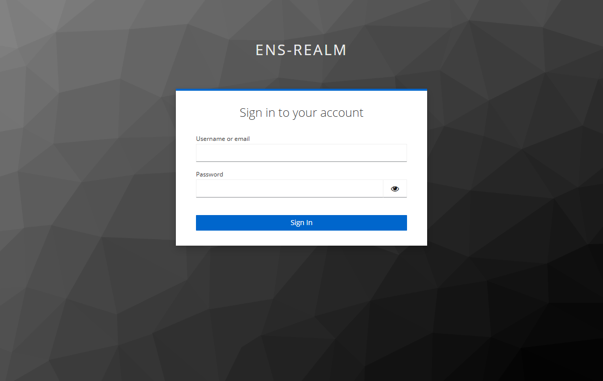
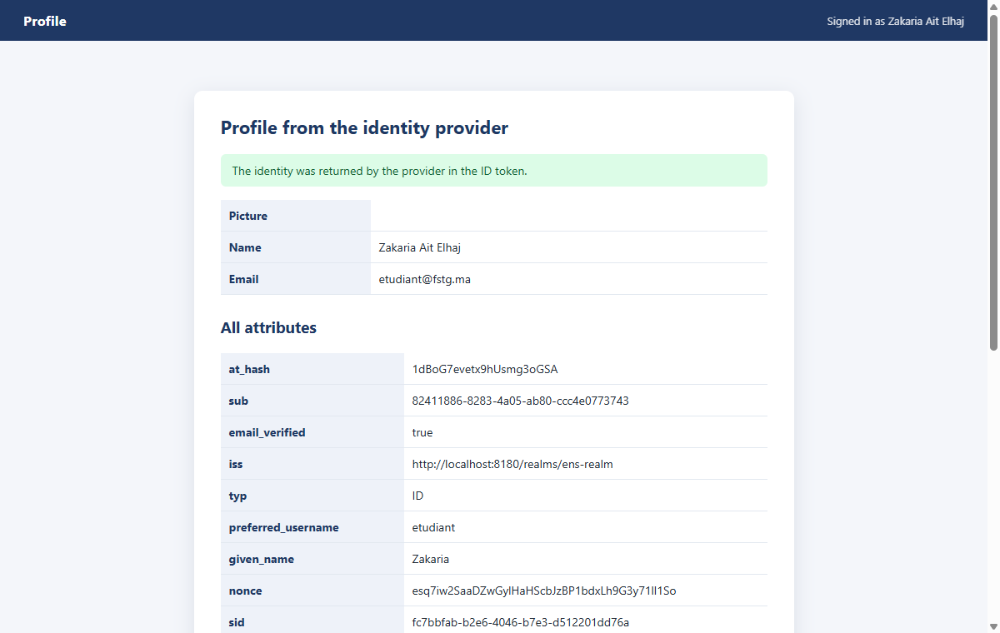

# J2E-Spring-TP13 — Intégration OAuth2 (Google / Keycloak)

TP 13 du cours *Développement JakartaEE : Spring* — authentification déléguée à un fournisseur OAuth2 / OpenID Connect.

## Connexion Keycloak (testée en réel)





## Stack

`Java 17` · `Spring Boot 3.3` · `spring-boot-starter-oauth2-client` · `Thymeleaf`

## Lancement du fournisseur Keycloak

Avec Docker :

```bash
docker run -d --name keycloak -p 8180:8080 \
  -e KEYCLOAK_ADMIN=admin -e KEYCLOAK_ADMIN_PASSWORD=admin \
  quay.io/keycloak/keycloak:23.0.7 start-dev
```

Sans Docker (distribution ZIP) :

```bash
bin/kc.bat start-dev --http-port=8180     # Windows
```

Puis dans la console <http://localhost:8180> (admin / admin) :

1. Créer le realm `ens-realm`
2. Créer le client `spring-oauth-client` (confidentiel), redirect URI
   `http://localhost:8085/login/oauth2/code/keycloak`
3. Créer un utilisateur, par exemple `etudiant / etudiant`

## Lancer l'application

```bash
mvn spring-boot:run   # http://localhost:8085
mvn test
```

Variables d'environnement (toutes optionnelles, valeurs locales par défaut) :

| Variable | Défaut |
|---|---|
| `KEYCLOAK_BASE_URL` | `http://localhost:8180` |
| `KEYCLOAK_REALM` | `ens-realm` |
| `KEYCLOAK_CLIENT_ID` | `spring-oauth-client` |
| `KEYCLOAK_CLIENT_SECRET` | `spring-oauth-client-secret` |
| `GOOGLE_CLIENT_ID` / `GOOGLE_CLIENT_SECRET` | non configurés |

## Google

Créer un identifiant OAuth 2.0 dans Google Cloud Console, puis :

```
GOOGLE_CLIENT_ID=xxxx.apps.googleusercontent.com
GOOGLE_CLIENT_SECRET=GOCSPX-xxxx
```

URI de redirection autorisée : `http://localhost:8085/login/oauth2/code/google`

## Flux

```
GET /profile (protégé)
  → 302 /login  (choix du fournisseur)
  → /oauth2/authorization/keycloak
  → page de login du fournisseur
  → /login/oauth2/code/keycloak  (échange code → access token + ID token)
  → /profile  avec les attributs OIDC
```

Aucun identifiant n'est stocké par l'application : `@AuthenticationPrincipal OAuth2User` expose
les claims du ID token (`sub`, `name`, `email`, `picture`…). Les endpoints sont déclarés explicitement
(`authorization-uri`, `token-uri`, `user-info-uri`, `jwk-set-uri`) plutôt que via `issuer-uri`, pour que
l'application démarre même si le fournisseur est injoignable.

## Tests

**5/5** — `OAuth2FlowTest` : page publique, redirection des anonymes, attributs affichés sur `/profile`,
endpoint JSON des claims, logout.

Auteur : [zAK4-7](https://github.com/zAK4-7)
